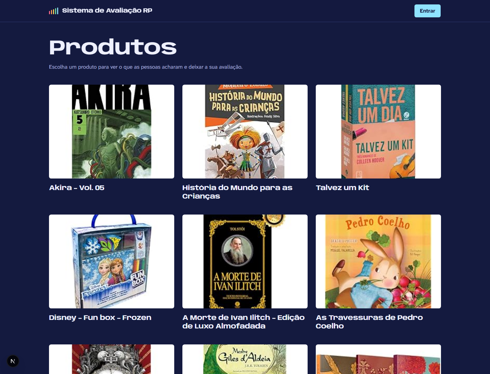
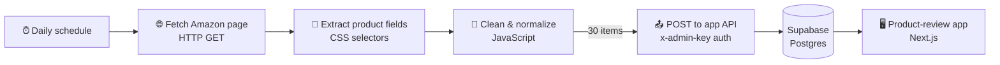

# Amazon → App Product Pipeline (n8n)


An **n8n automation** that scrapes the Amazon Brazil Black Friday page, cleans and validates the product data, and loads it into my product-review web app through an authenticated REST API. It runs on a schedule, with no manual steps.



---

## How it works



| Step | n8n node | What it does |
|---|---|---|
| 1 | **Daily schedule** | Starts the run automatically. |
| 2 | **Fetch Amazon page** | Downloads the HTML of `amazon.com.br/blackfriday`. |
| 3 | **Extract product fields** | Uses CSS selectors to pull out each product's name, price, link and image. |
| 4 | **Clean & normalize** | Splits the data into one item per product, makes every link an absolute `https://` URL, shortens product links to `/dp/<ASIN>`, and drops incomplete products. ([code](src/clean-and-normalize.js)) |
| 5 | **POST to app API** | Sends each product to `POST /api/v1/products`, authenticated with an `x-admin-key` header. |

The app validates every product with **Zod** before saving it. Invalid data gets a `400` response that names the failing fields.

## Tech stack

| Layer | Tools |
|---|---|
| Orchestration | **n8n** 2.x (self-hosted) |
| Runtime | **Docker Desktop** on Windows (WSL 2) |
| Extraction | HTTP Request + HTML nodes (CSS selectors) |
| Transformation | JavaScript (n8n Code node) |
| Destination | REST API built with **Next.js** route handlers, **Zod** validation, **Supabase** (Postgres) |
| Dev workflow | AI-assisted development and debugging with **Claude Code** |

## Run it yourself

**Prerequisites:** Docker Desktop, plus an API that accepts `POST` requests with `{ name, imageUrl, externalLink }`.

```bash
git clone https://github.com/Vinihs/n8n-amazon-product-pipeline.git
cd n8n-amazon-product-pipeline
docker compose up -d
```

1. Open **http://localhost:5678** and create your n8n owner account.
2. Go to **Workflows → Import from file** and choose [`workflow/amazon-product-pipeline.json`](workflow/amazon-product-pipeline.json).
3. In the **POST to app API** node, create a **Header Auth** credential with name `x-admin-key` and your API key as the value.
4. If your API isn't at `http://host.docker.internal:3000`, change the node's URL. Inside a container, `localhost` points to the container itself, so it can't reach your machine.
5. Click **Execute workflow**.

### API contract

```http
POST /api/v1/products
x-admin-key: <your key>
Content-Type: application/json

{ "name": "Akira - Vol. 05",
  "imageUrl": "https://m.media-amazon.com/images/I/518lpuADmxL._AC_SR240,220_.jpg",
  "externalLink": "https://www.amazon.com.br/dp/8545712367" }
```

| Status | Meaning |
|---|---|
| `201` | Product created and returned with `id` and `createdAt`. |
| `400` | Invalid data. `error.fields` says which field failed and why. |
| `401` | `x-admin-key` is missing or wrong. |

## What I learned

Most of this project's value was in the problems along the way:

1. **n8n works item by item.** My first output was *one* item holding 30-element arrays, so the HTTP node made a single request with empty fields. Returning **one item per product** made the HTTP node send 30 requests on its own.
2. **Field names are part of the contract.** The scraper produced `url` and `image`, and the API expected `imageUrl` and `externalLink`. The API's `400` response listed the failing fields, so the fix was quick.
3. **Scraped links are often relative.** Amazon's `href`s look like `/Some-Book/dp/8535947183?...tracking`. I made them absolute and reduced them to the clean `https://www.amazon.com.br/dp/<ASIN>` form.
4. **Check the data before you trust it.** The page gave 30 names but 58 links and 66 images, because other carousels share the same CSS classes. I checked that the first 30 of each list belong to the same product before pairing them by position.
5. **A broad `try/catch` can hide a bug.** `new URL()` doesn't exist in n8n's Code sandbox. Every call failed inside a `try`, returned `null`, and my filter quietly dropped all 30 products. I rewrote it with plain string handling.
6. **Read the execution data instead of guessing.** n8n keeps every run in its SQLite database. Reading the exact data each node produced found the problem faster than changing things at random.
7. **Containers have their own network.** `localhost` inside Docker is the container itself, so reaching an app on the host needs `host.docker.internal`.
8. **Antivirus can break HTTPS in containers.** Kaspersky replaces site certificates with its own, which Windows trusts but the container doesn't. Adding its root certificate with `NODE_EXTRA_CA_CERTS` fixed it.
9. **Hardened images limit community nodes.** A Playwright node crash-looped n8n because the official Alpine image can't install a browser. Running the browser as a separate container ([browserless](https://github.com/browserless/browserless)) avoids the problem.

## Roadmap

- [ ] **Avoid duplicates.** Upsert by ASIN so each run updates products instead of adding them again.
- [ ] **Scrape per product card** instead of pairing parallel lists by position.
- [ ] **Use an LLM** to generate a short description and category for each product before saving it.
- [ ] **Store prices** and track how they change over time.
- [ ] **Send an alert** (e-mail or Slack) when a run fails or finds zero products.

---

> **Disclaimer:** this is an educational project. Scraping may go against a website's terms of use. Amazon's terms don't allow automated data collection, so don't use this for commercial purposes. For production use, Amazon's official Product Advertising API is the right tool.

Built by **[Vinicius Robles](https://www.linkedin.com/in/viniciusrobles/)**: Analytics Engineer studying Applied AI Engineering.
